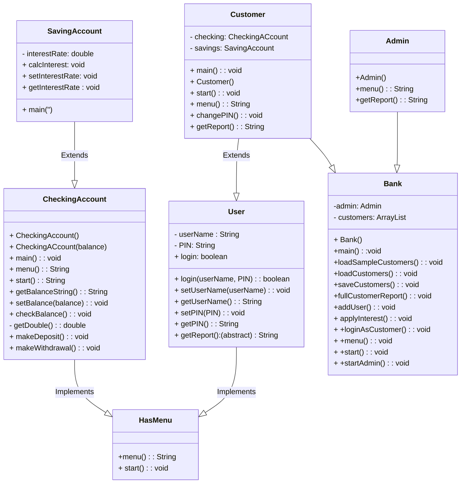

# bankOnit2

## Bank

Bank.start:
    display bank menu
    if user chooses admin login:
        ask for admin user and pin
        if login successful:
            start admin menu
        else if user chooses customer login:
            call loginascustomer
        else if user chooses exit:
            exit
Bank.loginAsCustomer():
    ask for customer user and pin
    for each customer
        if user and pin match
            start customer menu
            stop searching
    if no matching customer found
        display login error
Bank.addUser()
    ask for new customer name and pin
    create new customer object
    add customer to customer list
    display confirmation
Bank.applyInterest()
    for each customer in customer list
        calculate interest on savings account
        update savings balance
Bank.loadCustomers()
    try to open customers.dat
        read saved customer list
        store it in the customers arraylist
    if file does not exist
        load sample customers
Bank.saveCustomers()
    open customers.dat for writing
    write customers arraylist to file
    close file
Customer.start()
    while customer has not exited
        display menu
            allow customer to check balance, deposit money, withdraw, change pin
            exit when requested
